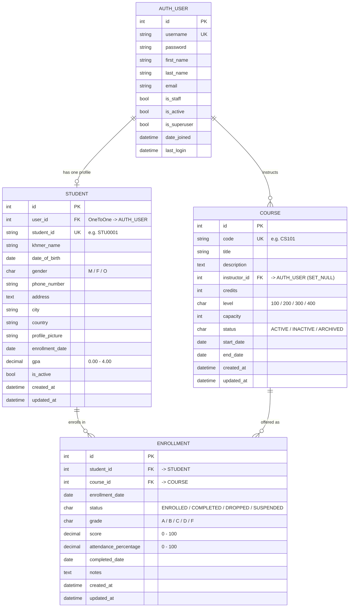

# BBU Student Management System — Entity Relationship Diagram

The database schema is built on Django's ORM (SQLite in development, PostgreSQL-ready for production).
Core entities: **User** (authentication), **Student** (academic profile), **Course** (catalog), and **Enrollment** (who studies what).

## Relationship notes

| Relationship | Type | On delete | Rule |
|---|---|---|---|
| `User` → `Student` | One-to-One | CASCADE | Every student profile belongs to exactly one login account |
| `User` → `Course` (`instructor`) | One-to-Many | SET_NULL | A teacher can instruct many courses; a course keeps its record if the teacher is removed |
| `Student` → `Enrollment` | One-to-Many | CASCADE | Deleting a student removes their enrollment records |
| `Course` → `Enrollment` | One-to-Many | CASCADE | Deleting a course removes its enrollment records |
| `Enrollment` (student, course) | Unique pair | — | A student cannot enroll twice in the same course |

## Business rules captured in the schema/code

1. **Unique student ID** — `students_student.student_id` is unique (e.g. `STU0001`).
2. **Unique course code** — `courses_course.code` is unique (e.g. `CS101`).
3. **No duplicate enrollment** — `unique_together = ('student', 'course')` on `enrollments_enrollment`.
4. **Auto letter-grade** — `Enrollment.save()` derives grade from score (≥90 A, ≥80 B, ≥70 C, ≥60 D, else F).
5. **Course capacity** — new `ENROLLED` records are blocked when `COUNT(status='ENROLLED') >= course.capacity`.
6. **GPA scale** — MoEYS: A=4.0, B+=3.5, B=3.0, C+=2.5, C=2.0, D=1.5, F=0, credit-weighted.
7. **Indexes** — fast lookups on `student_id`, `khmer_name`, `status`, and the `(student, course)` pair.

## How to export this diagram for the report

1. Open https://mermaid.live and paste the fenced `mermaid` block above.
2. Export as **PNG** (recommended: 2x scale) and insert it into your report document.
3. Alternatively, GitHub renders the diagram automatically when viewing this file.
